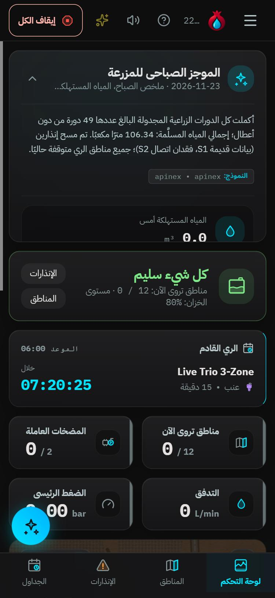
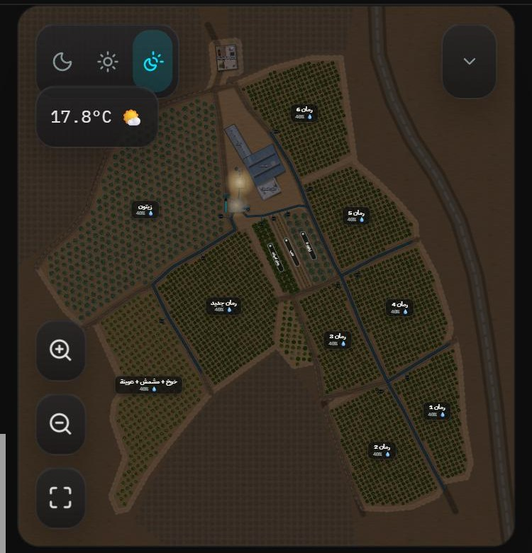
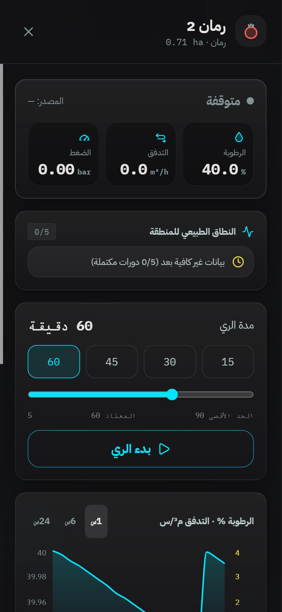
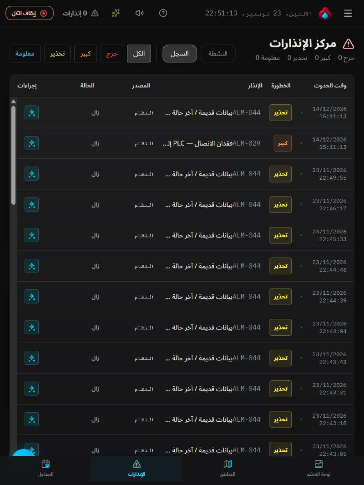
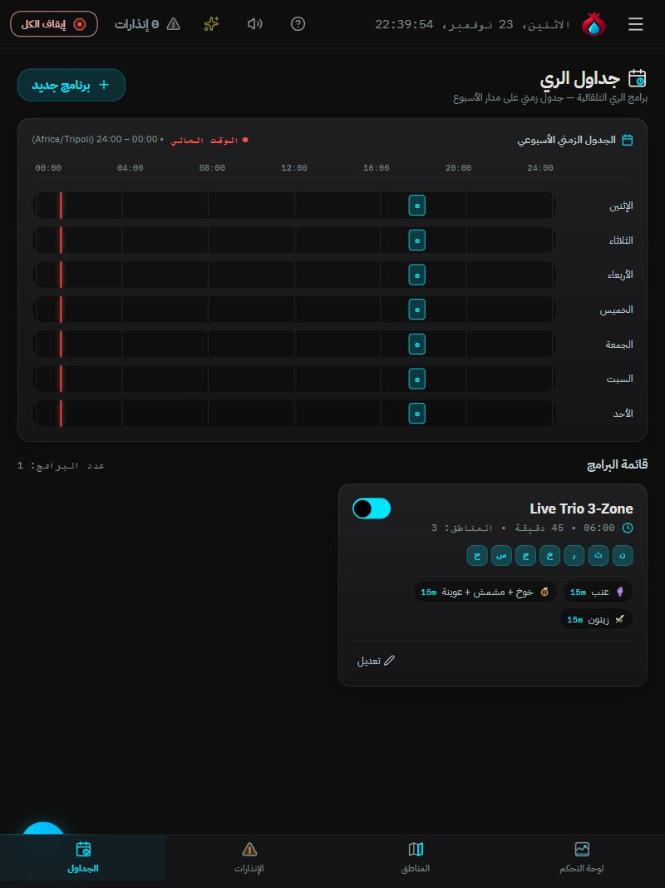
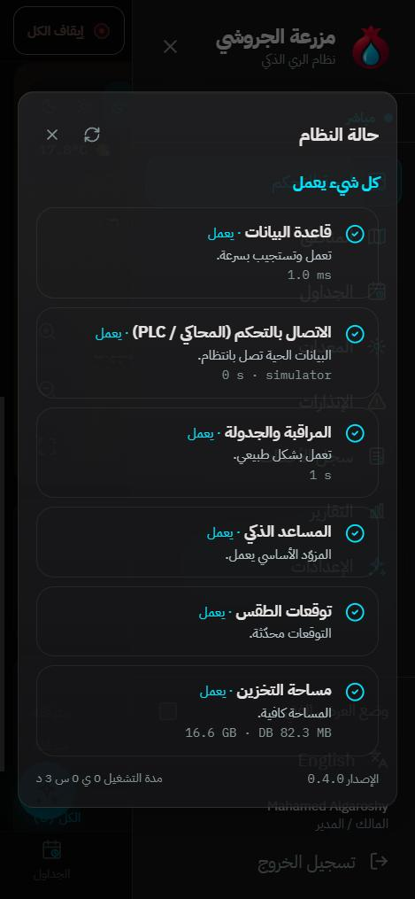
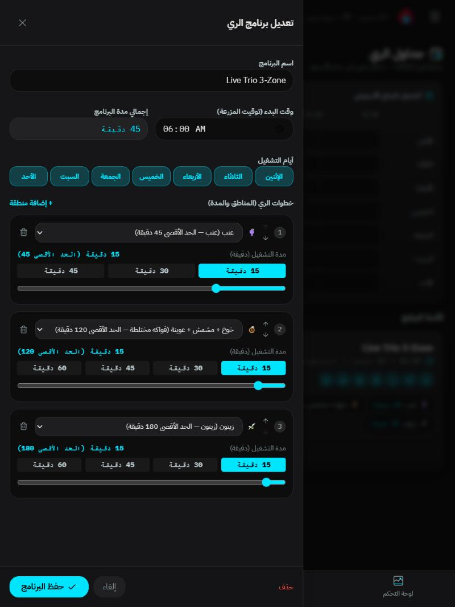
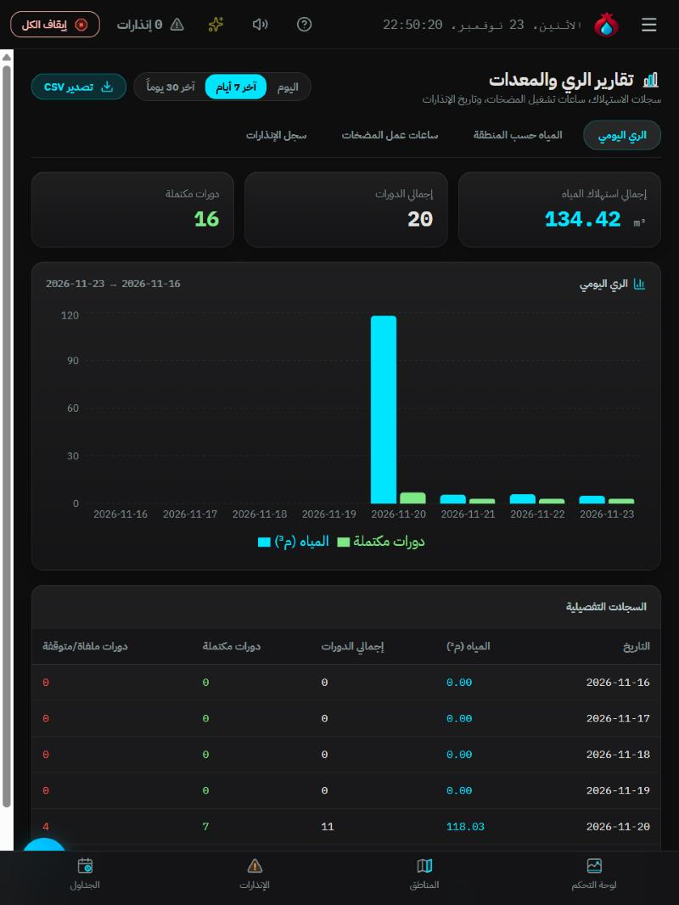
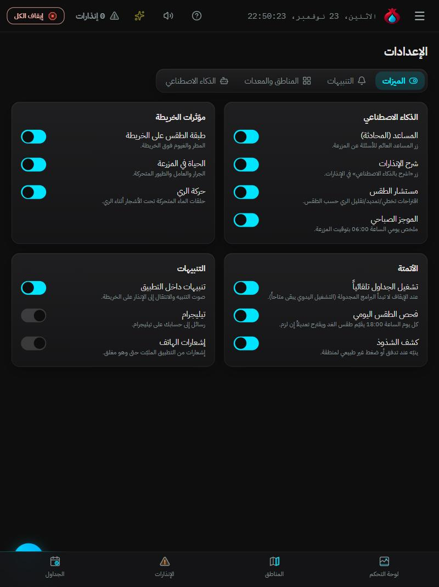

<!-- Generated from apps/web/src/content/guide.json by apps/web/scripts/build-guide.mjs. Edit the JSON, not this file. -->

# دليل المشغّل — نظام الري الذكي لمزرعة الجروشي
# Operator guide — Algaroshy Farm smart irrigation

**الإصدار / Version:** 2026-11-23 · PDF: [العربية](../apps/web/public/guide/operator-guide-ar.pdf) · [English](../apps/web/public/guide/operator-guide-en.pdf) · In the app: the **?** button in the top bar.

---

## العربية

هذا الدليل في جزأين: الجزء الأول للتشغيل اليومي (لكل من يستخدم النظام)، والجزء الثاني للإدارة (لمالك المزرعة). الأرقام في النظام تُكتب دائماً بالأرقام الإنجليزية (1، 2، 3)، والأوقات بتوقيت المزرعة (طرابلس).

### الجزء الأول: التشغيل اليومي

#### الدخول وتثبيت التطبيق على الهاتف

1. افتح عنوان النظام في المتصفح (يظهر في نافذة التشغيل على الحاسوب).
2. أدخل اسم المستخدم وكلمة المرور التي أعطاك إياها المالك.
3. على الهاتف: من قائمة المتصفح اختر «إضافة إلى الشاشة الرئيسية» ليعمل كتطبيق.

- المالك / المدير: كل شيء، بما فيه الإعدادات وإعادة ضبط الإنذارات.
- المشغّل: تشغيل وإيقاف المناطق، تأكيد الاطلاع على الإنذارات، تفعيل أو تعطيل البرامج.
- المشاهد: عرض فقط.

> ℹ️ اللغة: زر «English» في القائمة يبدّل بين العربية والإنجليزية.

> ℹ️ بعد 10 محاولات خاطئة خلال دقيقة يتوقف الدخول لهذا الاسم دقيقة. لتغيير كلمة مرورك: القائمة ← «تغيير كلمة المرور»، فتخرج الأجهزة الأخرى من حسابك.

#### لوحة التحكم

أول صفحة تراها. في الأعلى الموجز الصباحي (ملخص الأمس وجدول اليوم والطقس). تحته أربعة أرقام: المناطق التي تُروى الآن، المضخات العاملة، التدفق، والضغط الرئيسي. على الهاتف تظهر بطاقة الحالة أولاً: خضراء «كل شيء سليم»، أو بلون أخطر إنذار مفتوح.

- الري القادم: البرنامج التالي والعدّ التنازلي حتى موعده.
- مستوى الخزان: النسبة، وهل البئر يعيد ملأه.
- المضخات: مضخة البئر ومضخة التعزيز وحالتهما.
- الإنذارات والاتجاهات: آخر الإنذارات ورسوم الخزان والتدفق ومياه اليوم.

#### خريطة المزرعة

الخريطة مرسومة من صور الأقمار الصناعية للمزرعة. كل منطقة ري لها حدودها وأشجارها. لون المنطقة يدل على حالتها:

- أزرق مضيء: تُروى الآن (والماء يتحرك في الأنابيب).
- أصفر: بدء أو إيقاف قيد التنفيذ.
- أحمر: عطل أو إنذار على المنطقة.
- بدون لون: متوقفة.

> ℹ️ اضغط على أي منطقة لفتح لوحتها. زر الدليل على الخريطة يشرح الألوان، وأزرار الإضاءة تبدّل بين النهار والليل.

#### تشغيل منطقة وإيقافها

1. اضغط على المنطقة في الخريطة أو في صفحة «المناطق».
2. اختر مدة الري (أزرار جاهزة أو الشريط). «المعتاد» هو مدتها الافتراضية، و«الحد الأقصى» لا يمكن تجاوزه.
3. اضغط «بدء الري» ثم «تأكيد البدء». يظهر «تم قبول أمر البدء» ثم تتحول المنطقة إلى «تروى».
4. للإيقاف: افتح المنطقة واضغط «إيقاف المنطقة».

> ⚠️ إذا رُفض الأمر يظهر السبب (مثلاً: الخزان منخفض، مضخة معطلة، إنذار حرج مفتوح، أو عدد المناطق العاملة وصل الحد). هذه حمايات مقصودة؛ عالج السبب ثم أعد المحاولة.

> ⚠️ زر «إيقاف الكل» في أعلى الشاشة يوقف كل المناطق العاملة فوراً بعد التأكيد. استخدمه عند أي خطر.

في لوحة المنطقة أيضاً: الرطوبة والتدفق والضغط الحالية، النطاق الطبيعي للتدفق والضغط، سجل آخر دورات الري، وحالة الصمام.

> ⚠️ «إيقاف الكل» (من التطبيق أو من شاشة اللوحة) يوقف الماء وينهي البرنامج الجاري كله. يظهر أعلى الشاشة «تم التأكيد» فقط عندما تؤكد وحدة التحكم. إن لم تؤكد، أوقف من لوحة التحكم؛ التطبيق يستمر بإرسال الإيقاف ويرفع إنذاراً.

- بعد وضع مفتاح المنطقة على «تشغيل» لا يبدأ الماء إلا إذا رأت وحدة التحكم المفتاح على «إيقاف» قبلها.
- زر الطوارئ يوقف كل المضخات. الخزان المنخفض جداً يمنع مضخة التعزيز. عطل حساس الخزان يوقف التعبئة، وعطل حساس البئر يمنع مضخة البئر.
- صمام لم يُغلق يمنع أي تشغيل حتى تعالجه وتعيد ضبط الإنذار.
- وضع الصيانة أو الإيقاف يمنع التشغيل ويبقى بعد إعادة تشغيل وحدة التحكم.
- بعد انقطاع الكهرباء تُستأنف المنطقة فقط إن كان الانقطاع أقل من 30 دقيقة ولم تضغط أي إيقاف أثناءه.

#### الإنذارات: ماذا أفعل؟

عند إنذار جديد يُسمع صوت تنبيه وتتحرك الخريطة إلى مكانه. للإنذارات أربع درجات:

- حرج (أحمر، S3): خطر على المعدات أو المياه — تصرّف فوراً.
- كبير (برتقالي، S2): مشكلة توقف الري أو تهدر الماء — تصرّف اليوم.
- تحذير (أصفر، S1): شيء يحتاج متابعة.
- معلومة (أزرق، S0): للعلم فقط.

1. افتح «الإنذارات» واضغط على الإنذار لقراءة «الإجراء» المقترح.
2. اضغط «تأكيد الاطلاع» ليعرف الجميع أن أحداً يتابعه.
3. عالج السبب في الموقع (صمام، مضخة، تسريب…).
4. عندما يزول السبب: بعض الإنذارات تختفي وحدها، وبعضها يبقى «بانتظار إعادة الضبط» حتى يضغط المالك «إعادة ضبط».

> ℹ️ زر «اشرح» يطلب من المساعد الذكي شرحاً بالعربية: الأسباب المرجحة وخطوات الفحص. هي اقتراحات فقط؛ تحقق في الموقع ولا تتجاوز حمايات النظام. زر السماعة في الأعلى يكتم صوت الإنذار.

> ℹ️ «ساعة وحدة التحكم غير صحيحة» (ALM-051): افحص ساعة جهاز المزرعة والاتصال. «لم يصل أمر الإيقاف» (ALM-052): أوقف من لوحة التحكم فوراً.

#### جداول الري

البرنامج يروي مجموعة مناطق بالترتيب، في وقت محدد وأيام محددة. الجدول الأسبوعي يبيّن متى يعمل كل برنامج، والخط الأحمر هو الوقت الحالي.

> ℹ️ المشغّل يستطيع تفعيل البرنامج أو تعطيله بالمفتاح بجانبه. إنشاء البرامج وتعديلها للمالك (الجزء الثاني).

#### حالة النظام والاتصال

- «مباشر» أخضر: البيانات تصل لحظياً.
- «تحديث دوري» أو «بيانات قديمة»: الاتصال ضعيف؛ الأرقام قد تكون متأخرة.
- شارة حالة النظام في القائمة: خضراء تعمل، صفراء تحذير، حمراء عطل. اضغط عليها لترى أي جزء به مشكلة وماذا تفعل.

> ⚠️ إذا ظهر «تعذّر تحميل البيانات» في صفحة، اضغط «إعادة المحاولة». إذا استمر، تأكد أن الحاسوب الذي يشغّل النظام يعمل ومتصل بالشبكة.

> ⚠️ الشريط الأحمر «لا يوجد اتصال» يعني أن القيم على الشاشة قديمة. لا يمكن التشغيل، ويبقى الإيقاف متاحاً. تأكد من الواقع في المزرعة أو من لوحة التحكم.

#### المساعد الذكي

الزر العائم الأزرق يفتح المساعد. اسأله بالعربية عن حالة المزرعة، المضخات، الإنذارات أو الجداول؛ يجيب من البيانات الحية. إذا لم يتصل بالإنترنت يجيب بقواعد ثابتة ويظهر ذلك بوضوح.

> ⚠️ المساعد لا يشغّل ولا يوقف أي معدة. القرار دائماً للمشغّل، والحماية لوحدة التحكم.

### الجزء الثاني: الإدارة (للمالك)

#### إنشاء برنامج ري وتعديله

1. في «الجداول» اضغط «برنامج جديد» (أو «تعديل» على برنامج موجود).
2. اكتب الاسم واختر وقت البدء وأيام التشغيل.
3. أضف المناطق بالترتيب واختر مدة كل منطقة؛ الأسهم تغيّر الترتيب.
4. اضغط «حفظ البرنامج» ثم «تأكيد الحفظ».

> ℹ️ النظام يرفض البرنامج إذا تعارض مع برنامج آخر، أو تجاوز أقصى مدة لمنطقة، أو استخدم المضخة أكثر من المسموح، ويشرح السبب.

> ⚠️ البرنامج الجاري يُلغى ولا يُستأنف إذا توقف التطبيق، أو تغيرت الساعة فجأة، أو قطع انقطاع الكهرباء تشغيله، أو أُوقف أو عُدّل البرنامج أو أُوقفت الأتمتة. يُسجَّل السبب في سجل الأحداث.

#### توصيات مستشار الطقس

كل يوم الساعة 18:00 يفحص النظام طقس الغد. إذا توقع مطراً أو حراً شديداً تظهر بطاقة توصية: تخطي الري، تقليل المدة، أو تمديدها. القرار من قواعد ثابتة، والذكاء الاصطناعي يشرحه فقط.

1. اضغط «لماذا؟» لترى البيانات المستخدمة (المطر، الحرارة، رطوبة التربة…) والقاعدة.
2. «تطبيق لليوم فقط» يعدّل برنامج الغد فقط، ويمكن التراجع خلال ثوانٍ.
3. «تجاهل» يترك الجدول كما هو.

> ℹ️ التشغيل من اقتراح رطوبة التربة يحتاج ضغطتين، ولا يبدأ إن انتهت صلاحية الاقتراح أو لم تعد التربة جافة. زر «تراجع» يلغي قبولاً لم يستخدمه أي ري بعد.

#### التقارير

أربعة تقارير: الري اليومي، المياه حسب المنطقة، ساعات عمل المضخات، وسجل الإنذارات. اختر الفترة (اليوم، 7 أيام، 30 يوماً)، واضغط «تصدير CSV» لفتح البيانات في Excel بالعربية.

#### الإعدادات

- الميزات: مفاتيح تشغيل وإيقاف لكل ميزة ذكية، ومؤثرات الخريطة، والأتمتة (الجداول التلقائية، فحص الطقس اليومي، كشف الشذوذ)، وقنوات التنبيه. التغيير يصل لكل الشاشات فوراً.
- التنبيهات: الإنذارات الحرجة والكبيرة والموجز الصباحي تُرسل إلى تيليجرام وإشعارات الهاتف. اتبع الخطوات المكتوبة في الصفحة، ثم «إرسال رسالة تجريبية».
- المناطق والمعدات: عدّل اسم المنطقة ومحصولها وحدودها، أو أضف منطقة جديدة (يُنشأ معها صمامها وحساس رطوبتها)، أو أوقف منطقة بدل حذفها حتى يبقى سجلها.
- الذكاء الاصطناعي: النماذج المستخدمة، اختبار الاتصال، وسجل الاستخدام.

> ℹ️ إشعارات الهاتف تحتاج اتصالاً آمناً (HTTPS)؛ تعمل الآن على الحاسوب الذي يشغّل النظام، وعلى الهاتف بعد اختيار الاستضافة. المنطقة الجديدة تظهر على الخريطة بعد رسم حدودها.

- المستخدمون: أضف حساباً لكل شخص (مالك/مدير، مشغّل، مشاهد)، غيّر الدور أو كلمة المرور، أو عطّل الحساب. الحساب لا يُحذف، ولا يمكن تعطيل آخر مدير.
- إن نسيت كلمة مرور المدير: على جهاز المزرعة، داخل apps/api، شغّل: python -m app.reset_password ثم اسم المستخدم.
- النسخ الاحتياطي: نسخة يومية تلقائية، و«نسخ الآن». الاستعادة تُطبّق بعد إعادة التشغيل وتعيد كل السجلات وكلمات المرور القديمة. ملفات النسخ غير مشفرة.

#### سجل الأحداث

تُسجَّل الأوامر والإنذارات وعمليات الدخول وتغييرات المستخدمين والبرامج والأجهزة والإعدادات مع الوقت ومن قام بها. لا يوفّر التطبيق طريقة لتعديل السجل. استخدم الفلاتر (الأوامر، الإنذارات، الدخول) للبحث.

#### المحاكي وساعة المزرعة (للعرض فقط)

اليوم يعمل النظام مع محاكٍ يمثّل المزرعة ووحدة التحكم. شغّل «وضع العرض الفني» في القائمة لإظهار صفحة المحاكي: سيناريوهات جاهزة (تسريب، توقف مضخة…) وساعة افتراضية تسرّع الوقت حتى 360 مرة. «العودة إلى الوقت الحقيقي» تمسح سجل المحاكاة.

> ⚠️ عند ربط وحدة التحكم الحقيقية (PLC) يُقفل المحاكي والساعة الافتراضية تلقائياً.

---

## English

This guide has two parts: Part 1 is daily operation (for everyone who uses the system), Part 2 is administration (for the farm owner). Numbers are always written with Western digits (1, 2, 3), and times are farm time (Tripoli).

### Part 1: Daily operation

#### Signing in and installing on a phone

1. Open the system address in a browser (it is shown in the launcher window on the computer).
2. Enter the username and password the owner gave you.
3. On a phone: choose "Add to Home screen" from the browser menu so it opens like an app.

- Owner / admin: everything, including Settings and resetting alarms.
- Operator: start and stop zones, acknowledge alarms, switch programs on or off.
- Viewer: view only.

> ℹ️ Language: the «العربية» button in the menu switches between Arabic and English.

> ℹ️ After 10 wrong passwords within a minute, sign-in for that name pauses for a minute. To change your password: menu → “Change my password”; your other devices are signed out.

#### The dashboard

The first page you see. At the top is the morning briefing (yesterday's summary, today's plan and the weather). Below are four numbers: zones irrigating now, pumps running, flow, and main pressure. On a phone the status card comes first: green "All OK", or the colour of the most serious open alarm.

- Next irrigation: the next program and a countdown to it.
- Tank level: the percentage, and whether the well is refilling it.
- Pumps: the well pump and the booster pump and their state.
- Alarms and trends: recent alarms and charts of tank, flow and today's water.

#### The farm map

The map is traced from satellite images of the farm. Each irrigation zone has its own outline and trees. A zone's colour shows its state:

- Glowing blue: irrigating now (water moves in the pipes).
- Yellow: starting or stopping.
- Red: a fault or an alarm on the zone.
- No colour: off.

> ℹ️ Tap any zone to open its panel. The legend button on the map explains the colours; the light buttons switch between day and night.

#### Starting and stopping a zone

1. Tap the zone on the map or on the Zones page.
2. Choose the run time (preset buttons or the slider). "Usual" is its default run time; "max" cannot be exceeded.
3. Press "Start cycle", then "Confirm start". You see "Start command accepted", then the zone turns to "Irrigating".
4. To stop: open the zone and press "Stop zone".

> ⚠️ If a command is refused, the reason is shown (for example: tank low, pump faulted, a critical alarm open, or too many zones running). These are deliberate protections; fix the cause, then try again.

> ⚠️ The "STOP ALL" button at the top of the screen stops every running zone at once, after a confirmation. Use it whenever something is unsafe.

The zone panel also shows current moisture, flow and pressure, the normal flow and pressure range, recent irrigation runs, and the valve state.

> ⚠️ STOP ALL (in the app or on the panel screen) stops the water and ends the whole running program. The screen says “confirmed” only when the controller confirms. If it does not, stop at the control panel; the app keeps sending the stop and raises an alarm.

- A zone switch put on ON starts water only if the controller saw it OFF before.
- The emergency stop stops every pump. A critically low tank locks out the booster. A failed tank sensor stops refilling; a failed well sensor locks the well pump.
- A valve that did not close blocks every start until it is fixed and the alarm is reset.
- Maintenance and off modes block starts and survive a controller restart.
- After a power cut a zone resumes only if the cut was under 30 minutes and nobody pressed any stop during it.

#### Alarms: what do I do?

When a new alarm arrives you hear a chime and the map flies to it. Alarms have four levels:

- Critical (red, S3): danger to equipment or water — act now.
- Major (orange, S2): a problem that stops irrigation or wastes water — act today.
- Warning (yellow, S1): something to watch.
- Info (blue, S0): for information only.

1. Open Alarms and tap the alarm to read the suggested action.
2. Press "Acknowledge" so everyone knows someone is on it.
3. Fix the cause on site (valve, pump, leak…).
4. When the cause is gone: some alarms clear by themselves; others stay "Waiting for reset" until the owner presses "Reset".

> ℹ️ The "Explain" button asks the AI assistant for an explanation: likely causes and checks. These are suggestions only; check on site and never bypass the system's protections. The speaker button at the top mutes the alarm sound.

> ℹ️ “PLC clock wrong” (ALM-051): check the farm PC's clock and the link. “Stop not delivered” (ALM-052): stop at the control panel at once.

#### Irrigation schedules

A program waters a list of zones one after another, at a set time on set days. The weekly timeline shows when each program runs; the red line is now.

> ℹ️ An operator can switch a program on or off with the switch next to it. Creating and editing programs is for the owner (Part 2).

#### System health and connection

- Green "Live": data arrives in real time.
- "Polling" or "Stale data": the connection is weak; numbers may be late.
- The system health badge in the menu: green working, amber warning, red fault. Tap it to see which part has a problem and what to do.

> ⚠️ If a page shows "Couldn't load the data", press "Try again". If it keeps happening, check that the computer running the system is on and connected.

> ⚠️ The red “No connection” bar means the values on screen are old. Starting is blocked and Stop stays available. Check at the farm or on the control panel.

#### The AI assistant

The blue floating button opens the assistant. Ask it in Arabic or English about the farm, pumps, alarms or schedules; it answers from live data. Without internet it answers with fixed rules and says so clearly.

> ⚠️ The assistant never starts or stops equipment. Decisions stay with the operator, and protection stays with the controller.

### Part 2: Administration (owner)

#### Creating and editing a program

1. On Schedules press "New program" (or "Edit" on an existing one).
2. Enter a name, the start time and the days.
3. Add zones in order and set each zone's run time; the arrows change the order.
4. Press "Save program", then "Confirm save".

> ℹ️ The system refuses a program that clashes with another one, exceeds a zone's maximum run time, or overloads the pump, and explains why.

> ⚠️ A running program is cancelled, not resumed, if the app was down, the clock jumped, a power cut ended its run, or the program or automation was switched off or edited. The event log records why.

#### Weather advisor suggestions

Every day at 18:00 the system checks tomorrow's weather. If it expects rain or strong heat, a suggestion card appears: skip, shorten or extend irrigation. The decision comes from fixed rules; the AI only explains it.

1. Press "Why?" to see the inputs (rain, heat, soil moisture…) and the rule.
2. "Apply for today" changes only that day's program, with a few seconds to undo.
3. "Dismiss" leaves the schedule unchanged.

> ℹ️ Starting from soil advice takes two taps and is refused if the advice expired or the soil is no longer dry. Undo removes an approval no run has used yet.

#### Reports

Four reports: daily irrigation, water per zone, pump running hours, and alarm history. Pick a period (today, 7 days, 30 days) and press "Export CSV" to open the data in Excel.

#### Settings

- Features: on/off switches for each AI feature, map effects, automation (automatic schedules, the daily weather check, anomaly detection) and alert channels. Changes reach every screen at once.
- Notifications: critical and major alarms and the morning briefing go to Telegram and phone notifications. Follow the steps on the page, then "Send a test message".
- Zones & equipment: edit a zone's name, crop and limits, add a new zone (its valve and moisture sensor are created with it), or disable a zone instead of deleting it so its history stays.
- AI: the models in use, a connection test, and the usage log.

> ℹ️ Phone notifications need a secure connection (HTTPS); they work now on the computer running the system, and on phones once hosting is chosen. A new zone appears on the map once its outline is drawn.

- Users: add an account per person (owner/admin, operator, viewer), change a role or password, or disable it. Accounts are not deleted, and the last admin cannot be disabled.
- If the admin password is lost: on the farm PC, in apps/api, run python -m app.reset_password followed by the username.
- Backups: one automatic copy a day, plus “Back up now”. A restore applies at the next start and brings back all old records and passwords. Backup files are not encrypted.

#### The event log

Commands, alarms, sign-ins and changes to users, programs, devices and settings are recorded with the time and who did it. The app offers no way to edit the log. Use the filters (commands, alarms, sign-ins) to search.

#### The simulator and farm clock (demo only)

Today the system runs with a simulator that plays the farm and the controller. Turn on "Presenter mode" in the menu to show the Simulator page: ready scenarios (leak, pump trip…) and a virtual clock that runs up to 360× faster. "Back to real time" clears the simulation history.

> ⚠️ When the real controller (PLC) is connected, the simulator and virtual clock are locked automatically.
